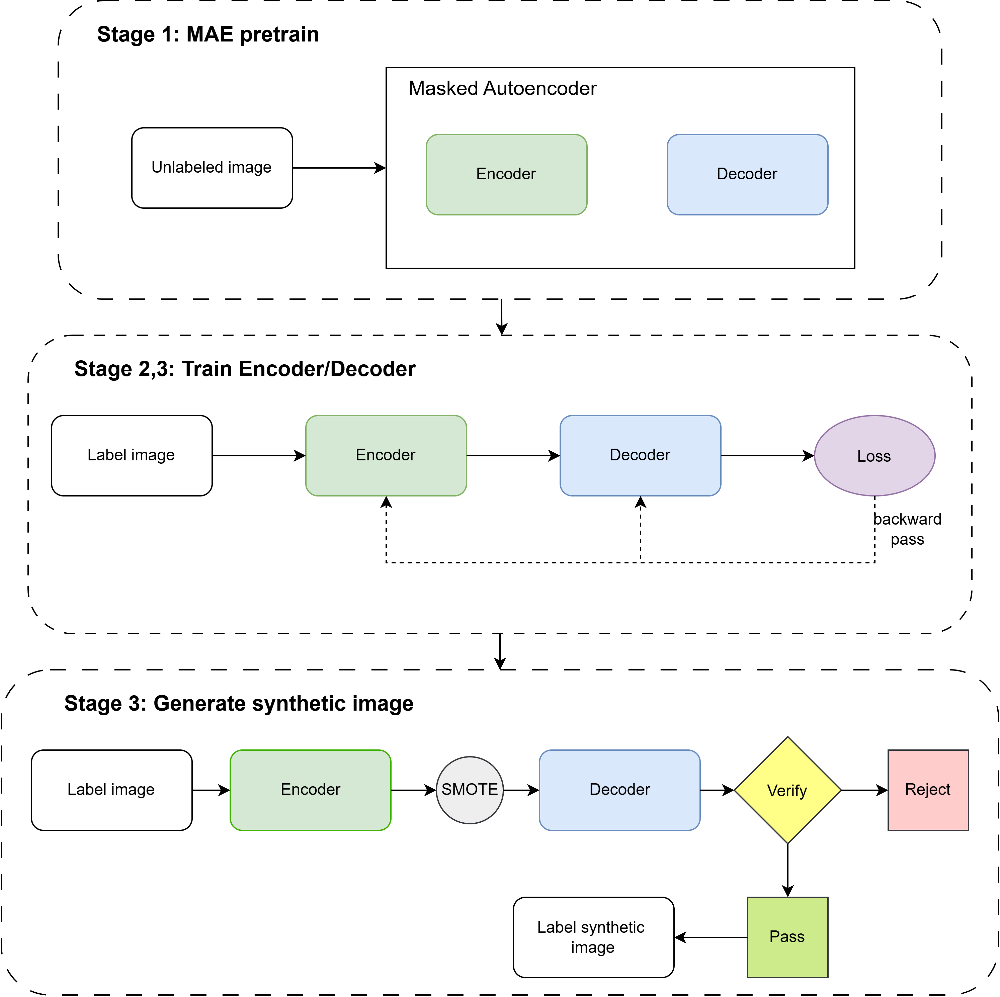

## Self-supervised DeepSMOTE

ssDeepSMOTE balances the classes of an imbalanced blood-cell dataset by generating synthetic images of the minority classes.



## Dataset

- Download the dataset: [here](https://drive.google.com/file/d/1cjF-u4uQyNKCMxZr_Bb4VVpdK4Knl1zJ/view?usp=sharing)
- Source: Barcelona PBC dataset (Acevedo et al., Data in Brief 2020). Peripheral blood smear photographs (~360x363 JPG), with COCO-format bounding boxes for every cell.
- 8 classes: BA (basophil), EO (eosinophil), ERB (erythroblast), IG (immature granulocyte), LYM (lymphocyte), MONO (monocyte), NEUT (neutrophil), PLT (platelet).
  - The labels come from the bbox category, not the filename prefix. Filename prefixes such as BNE/SNE (neutrophils) or MY/MMY/PMY (IG) are sub-types.
  - Platelets often appear next to other cells, so one image can hold several boxes.
- Layout (unzip so it sits at `ssdeepsmote/dataset/`):
```
dataset/
  train/  val/  test/                     *.jpg
  annotations/{train,val,test}.json       COCO: images, annotations (bbox), categories
```
- Bounding-box (cell) counts per split:

| Split | Images | BA | EO | ERB | IG | LYM | MONO | NEUT | PLT | Total |
|---|---|---|---|---|---|---|---|---|---|---|
| train | 11,458 | 497 | 2,243 | 1,001 | 2,191 | 613 | 791 | 2,746 | 4,646 | 14,728 |
| val | 2,100 | 302 | 301 | 314 | 308 | 307 | 306 | 326 | 2,297 | 4,461 |
| test | 2,100 | 301 | 303 | 321 | 308 | 311 | 308 | 336 | 2,281 | 4,469 |

## How to run
- Assume that conda environment is already installed
- Run:
```
cd ssdeepsmote
bash scripts/setup_env.sh
conda activate ssdeepsmote
bash scripts/run_all.sh
```
- You can observe output or download trained model from [here](https://drive.google.com/file/d/1Ks3AgaIXAuk2ZqWKYtsk37fl07auKI9A/view?usp=sharing)

## How to run with other dataset
- It should be in COCO format as the dataset used in this repo
- Validate set is required

- Change `configs/common.yaml`, listing your classes and the matching COCO `category_id`:
```yaml
paths:
  dataset_root: /path/to/my_dataset
  output_root: outputs_my_dataset
data:
  classes: [CLASS_A, CLASS_B, CLASS_C]
  category_ids: [1, 2, 3]
  size_norm: 400.0          # about the largest crop side in pixels
  pad_fill: [0, 0, 0]       # background colour used to pad crops to a square
stage0:
  expected_counts: null     # turns off the check against the PBC counts
```